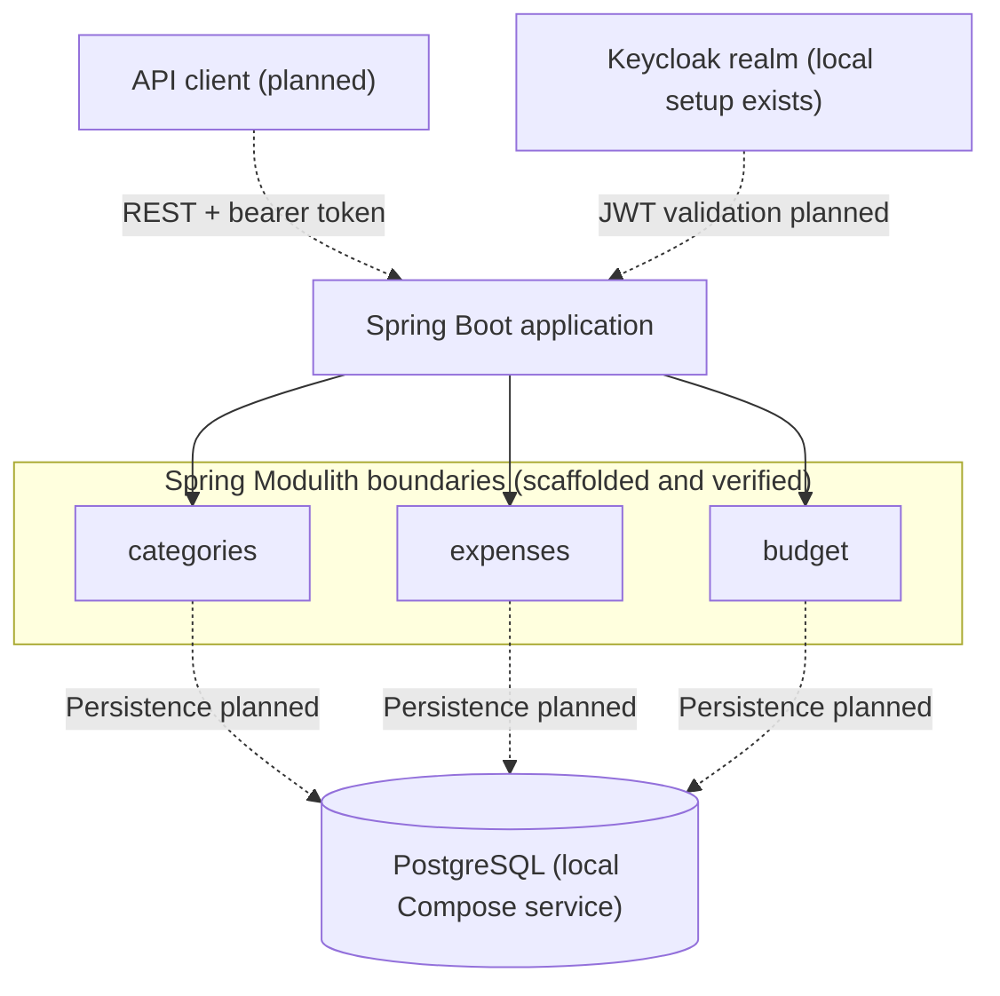

# Smart Budget

**Kotlin · Spring Boot · Spring Modulith · Java 21**

Smart Budget is an **in-progress personal budgeting application** designed as a Kotlin-first, modular Spring Boot backend. The goal is to support expense categories, monthly spending limits, transactions and summaries, with strict isolation between users.

The project prioritizes domain boundaries, security, testability and documented architectural decisions over introducing infrastructure without a concrete requirement.

> **Current status:** the backend foundation and architecture documentation are in place. The complete budgeting workflow is **not yet implemented**. Descriptions below distinguish existing work from the planned implementation.

## Current implementation

| Area | Available now | Planned next |
| --- | --- | --- |
| Runtime | Kotlin 2.2, Java 21, Spring Boot, Gradle Kotlin DSL | Complete application features |
| Architecture | A single deployable `app` and verified Spring Modulith boundaries for `categories`, `expenses` and `budget` | Implement module APIs and business logic |
| Local environment | Docker Compose for the application, PostgreSQL and a Keycloak realm with two demo users | Connect application persistence and API security |
| Quality | Gradle build, GitHub Actions and module architecture tests | Unit, integration and cross-user isolation tests |
| Design | C4 source model, ADRs, requirements, user stories and roadmap | Record further trade-offs as implementation evolves |
| Cloud | No deployed AWS environment | Hosting comparison, Terraform and basic observability at M3 |

The local services and Keycloak realm configuration do **not** imply that PostgreSQL persistence or JWT validation has been integrated into the application yet.

## Architecture and decisions

The first milestone uses a **modular monolith**: one deployable Spring Boot application with three logical business modules. Spring Modulith detects module boundaries and verifies dependencies. Cross-module communication is intended to use explicit public APIs; module-owned data will reside in a single PostgreSQL database.



*Solid connections represent the existing module structure; dotted connections represent planned application integration. This diagram is a simplified view of the M1 target.*

**Why not microservices?** The project does not yet need independent deployment or distributed communication. A modular monolith makes boundaries testable without additional deployment, networking and operational complexity. See [ADR 0001 — modular monolith first](docs/architecture/adr/0001-modular-monolith-first.md).

Further decisions:
- [ADR 0002 — module boundaries and data ownership](docs/architecture/adr/0002-module-boundaries-and-data-ownership.md)
- [ADR 0003 — authenticated owner identity](docs/architecture/adr/0003-authenticated-owner-identity.md)
- [C4 architecture source](docs/architecture/workspace.dsl)

These records specify the intended design; they are not evidence that every decision has been implemented.

## First functional milestone — M1 (not yet complete)

The initial API will support the following end-to-end workflow:

1. Authenticate as an owner and create personal categories.
2. Set an optional overall monthly limit and category-level limits.
3. Record a positive PLN expense against an owner-owned category.
4. List expenses by month and optionally category.
5. Get monthly totals, remaining budgets and advisory overspending warnings.
6. Verify that a second authenticated owner cannot access the first owner's data.

The backend will validate JWTs from Keycloak and derive the owner ID from trusted identity rather than a client-supplied value. PostgreSQL, Flyway, OpenAPI and integration tests are part of the approved M1 scope but are not all delivered.

[Detailed user stories](docs/user_stories.md) · [Requirements](docs/requirements.md) · [M1 roadmap](docs/roadmap.md)

## Build and local environment

Requirements: **JDK 21** for the build, and **Docker / Docker Compose** for the local environment.

```bash
cd server
./gradlew build
cd ..

cp .env.example .env
docker compose up --build --detach
docker compose ps
```

Use `gradlew.bat` and `Copy-Item .env.example .env` on Windows.

The default local endpoints are application health (`http://localhost:8080/actuator/health`), Keycloak (`http://localhost:8081`) and PostgreSQL (`localhost:5432`). This runs the current **baseline**, not a finished budgeting API.

For the full Keycloak demo setup, verification scripts, credentials and reset instructions, read [Local development](docs/local-development.md). Never commit local `.env` files, tokens or real credentials.

## Delivery roadmap

| Milestone | Outcome | Status |
| --- | --- | --- |
| M0 | Product documentation, architecture decisions and initial module baseline | Baseline established |
| M1 | Secure, owner-isolated budgeting backend | In progress |
| M2 | Lifecycle actions, subcategories and richer budgeting features | Planned |
| M3 | Cost-aware AWS deployment, Terraform and observability | Planned |
| M4 | Focused Angular frontend | Planned |
| M5+ | CSV import, recurring expenses and carefully scoped AI capabilities | Planned |

The [full roadmap](docs/roadmap.md) includes acceptance criteria, technical dependencies and explicitly excluded features.

## Documentation

- [Project context](CONTEXT.md) · [PRD](docs/prd.md) · [Technology stack and implementation status](docs/tech-stack.md)
- [User stories](docs/user_stories.md) · [Requirements](docs/requirements.md) · [Roadmap](docs/roadmap.md)
- [ADRs](docs/architecture/adr/0001-modular-monolith-first.md) · [C4 model](docs/architecture/workspace.dsl)
- [Local development guide](docs/local-development.md) · [Contributing](CONTRIBUTING.md) · [Agent instructions](AGENTS.md)
- [Historical microservices documentation](docs/archive/2025-microservices/README.md)

## Working principles

- Deliver small, reviewable vertical slices and validate assumptions with tests.
- Keep module interfaces explicit and avoid cross-module persistence coupling.
- Use authenticated owner identity for all owner-scoped operations when security is implemented.
- Document material choices, rejected alternatives and operational trade-offs in ADRs.
- Do not commit real credentials or secrets.

## License

[MIT](LICENSE).
